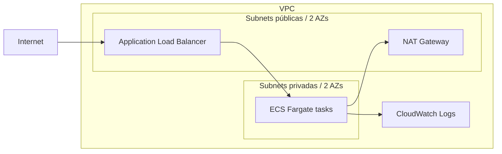
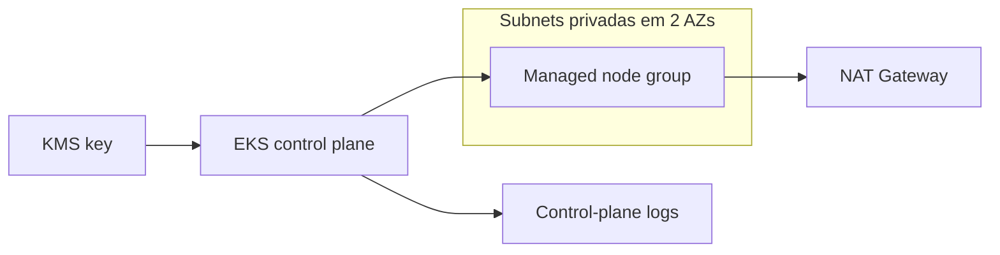
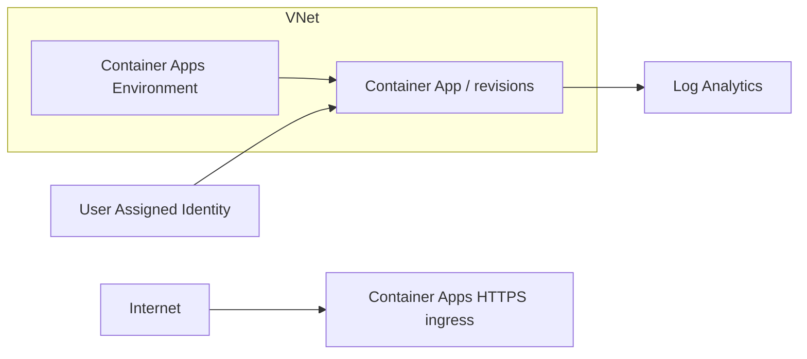
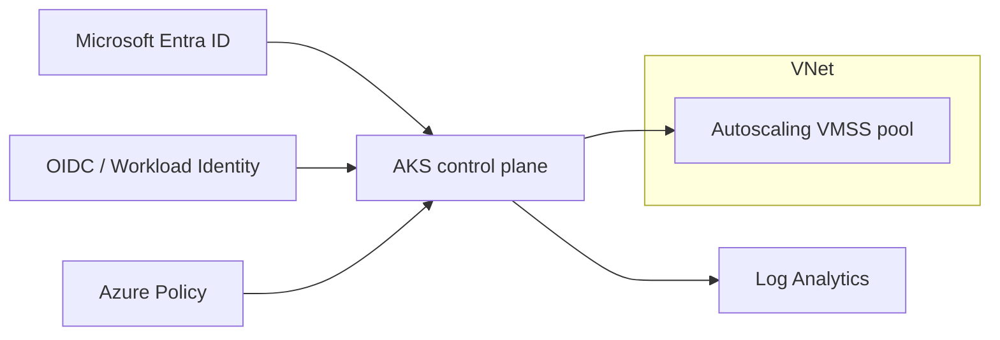
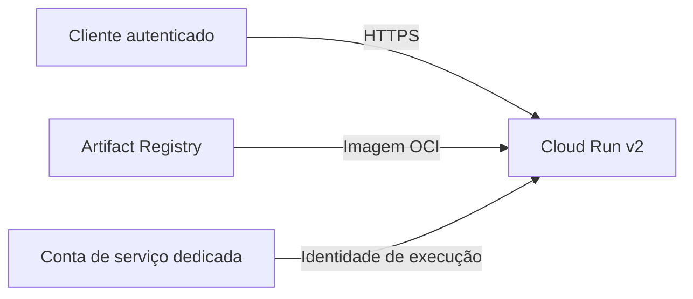
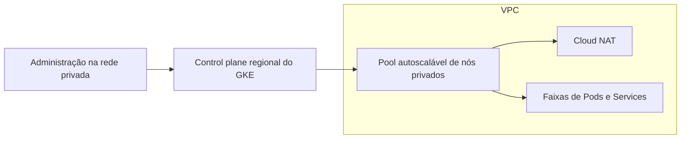

# Arquitetura

## AWS: container Docker

O load balancer é o único ponto de entrada. Tasks não recebem IP público e o
security group aceita tráfego apenas do ALB.

## AWS: Kubernetes

O cluster usa criptografia KMS para Secrets, logs de todos os componentes do
control plane, nodes privados e endpoint privado por padrão. Para habilitar o
endpoint público, forneça somente CIDRs confiáveis.

## Azure: container Docker

O runtime serverless suporta scale-to-zero e usa identidade gerenciada, sem
segredo estático no código.

## Azure: Kubernetes

Azure RBAC, OIDC e Workload Identity são habilitados. A API é privada por padrão
e exige conectividade com a VNet para uso do `kubectl`.

## GCP: container Docker

O serviço exige IAM para invocação. A stack cria um registry para imagens
próprias e usa a imagem de exemplo do Google na primeira implantação.

## GCP: Kubernetes

Os nós usam Workload Identity Federation para workloads e uma conta de
serviço dedicada para operações do GKE. O padrão usa nós em uma zona, com
opção de distribuí-los em mais zonas da região.

## Decisões

- ECS Fargate, Azure Container Apps e Cloud Run representam o caminho Docker
  com execução gerenciada.
- EKS, AKS e GKE cobrem os ambientes Kubernetes.
- Um NAT compartilhado reduz o custo do laboratório; produção pode adotar um
  NAT por AZ para remover esse ponto único de falha.
- O lockfile de cada ambiente fixa a versão do provider testada pelo CI.

