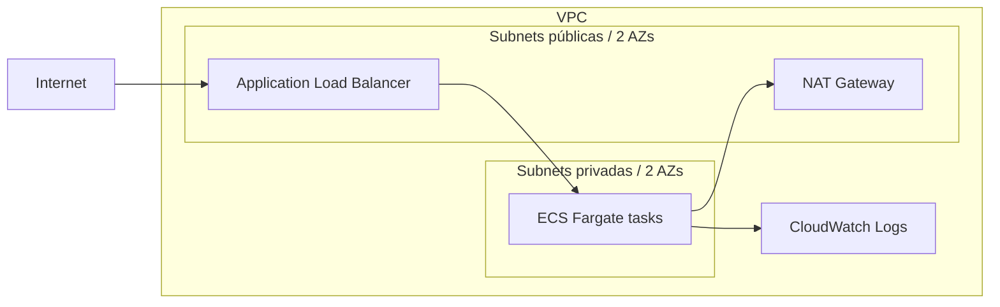
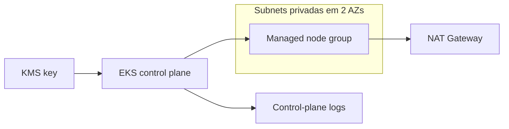
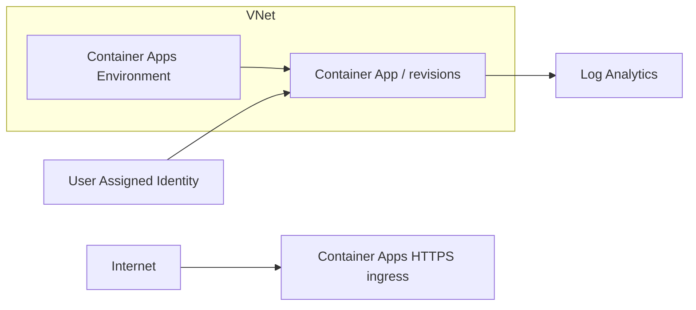
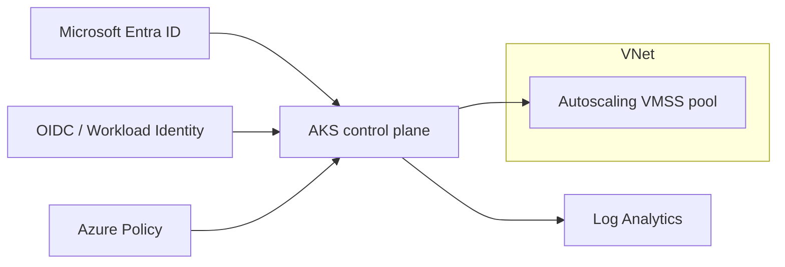

# Arquitetura

## AWS: container Docker

O load balancer é o único ponto de entrada. Tasks não recebem IP público e o
security group aceita tráfego apenas do ALB.

## AWS: Kubernetes

O cluster usa criptografia KMS para Secrets, logs de todos os componentes do
control plane, nodes privados e endpoint privado por padrão. Para habilitar o
endpoint público, forneça somente CIDRs confiáveis.

## Azure: container Docker

O runtime serverless suporta scale-to-zero e usa identidade gerenciada, sem
segredo estático no código.

## Azure: Kubernetes

Azure RBAC, OIDC e Workload Identity são habilitados. A API é privada por padrão
e exige conectividade com a VNet para uso do `kubectl`.

## Decisões

- ECS Fargate e Azure Container Apps representam o caminho Docker sem operação
  de VMs.
- EKS e AKS cobrem os ambientes Kubernetes solicitados.
- Um NAT compartilhado reduz o custo do laboratório; produção pode adotar um
  NAT por AZ para remover esse ponto único de falha.
- Os providers aceitam apenas a próxima major abaixo de `7.0`/`6.0`; o lockfile
  criado por `terraform init` fixa a versão efetivamente testada.

